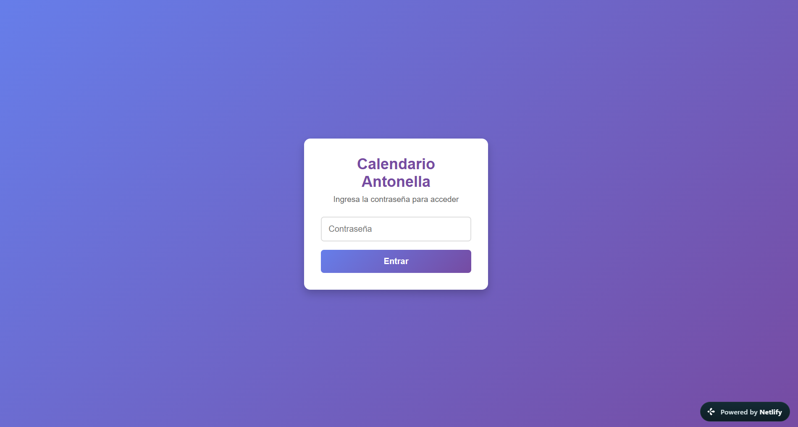
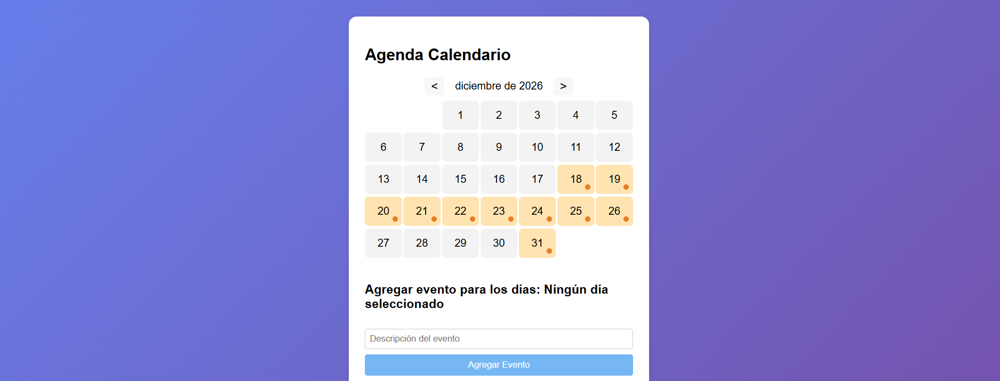
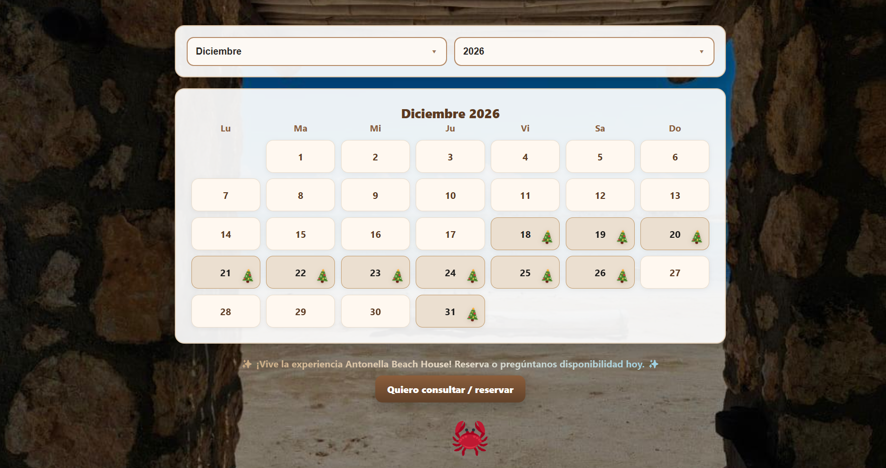

# Calendario Antonella Beach House

Agenda web para llevar el control de las fechas ocupadas de la casa. Tiene login con contraseña, guarda todo en Firebase y corre en Netlify.

Demo: https://espaciocalendario.netlify.app/

| Acceso | Calendario |
| --- | --- |
|  |  |

## Qué hace

- Pide una contraseña antes de mostrar nada.
- Muestra un calendario por mes, con botones para ir al mes anterior o al siguiente.
- Los días que ya están reservados se ven en naranja con un puntito.
- Puedo marcar varios días a la vez y guardarles un evento (por ejemplo, el nombre de quien reserva) de una sola vez.
- Si intento reservar un día que ya está ocupado, no me deja y me avisa cuáles son.
- Si le doy clic a un día ocupado, me sale el evento con un botón para **eliminarlo** (pide confirmación antes de borrar).
- Abajo tengo la lista de todos los eventos del mes.

## Calendario público

Los días que marco aquí también se ven en la página que usan los clientes para consultar disponibilidad: https://calendarioantonellabeachhouse.netlify.app/

Ahí los días ocupados salen marcados y los clientes pueden elegir el mes y el año, sin ver los nombres ni poder cambiar nada. También tiene un botón para consultar o reservar.



## Cómo está hecho

- HTML, CSS y JavaScript puro
- Netlify Functions (Node.js) como backend
- Firebase Firestore para guardar los eventos

## Seguridad

La página nunca habla directo con Firebase. Todo pasa por una función de Netlify que es la única que tiene las credenciales, guardadas como variables de entorno y no en el repo.

## Correrlo en local

```bash
npm install
npx netlify dev
```

Necesitas un archivo `.env` con las variables de la siguiente sección (ya está ignorado por git).

## Variables de entorno

De la cuenta de servicio de Firebase:

`FIREBASE_TYPE`, `FIREBASE_PROJECT_ID`, `FIREBASE_PRIVATE_KEY_ID`, `FIREBASE_PRIVATE_KEY`, `FIREBASE_CLIENT_EMAIL`, `FIREBASE_CLIENT_ID`, `FIREBASE_AUTH_URI`, `FIREBASE_TOKEN_URI`, `FIREBASE_AUTH_PROVIDER_X509_CERT_URL`, `FIREBASE_CLIENT_X509_CERT_URL`

## Desplegar

1. En Netlify: Add new site, Import from Git, y elige este repo.
2. En Site settings, Environment variables, carga las variables de arriba.
3. Despliega.
